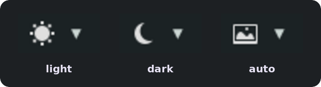
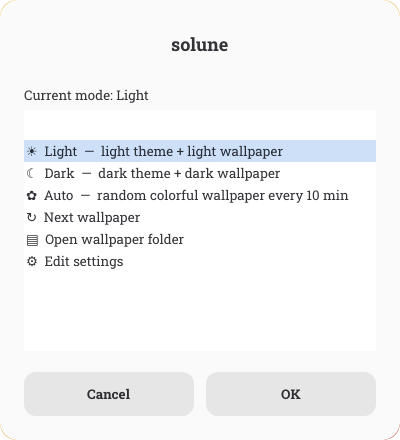
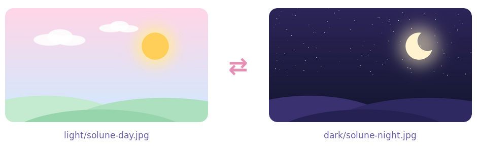

<p align="center">
  
</p>

<p align="center">
  <b>one click on your panel, and your whole XFCE desktop goes from (☀ ˘ω˘) to (☾ ᴗ˳ᴗ) zzz</b><br>
  theme, window borders, icons <i>and</i> the matching wallpaper, all at once, with a soft little fade ✨
</p>

<p align="center">
  
  
  
  
</p>

---

## ✨ what it does

- **☀ ⇄ ☾ in one click.** A little button on your XFCE panel switches the app theme, window borders, icon theme and panel all together.
- **Wallpapers that follow along.** Put a light and a dark version of the same picture in two folders. When you go dark, the dark version of *the same picture* shows up. No more blinding white wallpaper at midnight (>_<)
- **Pick by hand any time.** Chose a different wallpaper in XFCE's desktop settings? solune notices, and the next switch uses *that* picture's partner.
- **🎨 Auto mode.** Shows a random picture from a "colorful" folder and changes it every few minutes.
- **🌫 A soft crossfade.** The screen holds still while everything changes underneath, then gently fades into the new look. No flickering apps.
- **🐢 Gentle on slow laptops.** Big wallpapers are shrunk to your screen size once, in the background. The panel button never makes the panel stutter.
- **No coding needed.** Everything is folders and one small settings file.

## 🖼 a peek

| the panel button | the ▾ menu |
|:---:|:---:|
|  |  |
| click the icon to switch light ⇄ dark | click the ▾ for Auto, Next wallpaper and more |

## 🍡 install

```bash
git clone https://github.com/aymanshawon/solune.git
cd solune
./install.sh
```

That's it! No sudo needed (ﾉ◕ヮ◕)ﾉ*:･ﾟ✧

**Nothing to set up before installing.** Everything can be changed afterwards, any time (see [settings](#settings)).

The installer:
- puts solune in `~/.solune/` and adds the `solune` command;
- looks at the theme you use now and finds its light/dark partner, e.g. `Greybird` ⇄ `Greybird-dark` or `Papirus` ⇄ `Papirus-Dark`, and writes that to `~/.solune/solune.conf`;
- creates your wallpaper folders in `~/.solune-wallpaper/`, with a few sample pictures so it works right away;
- puts the button on your panel, next to the clock (your old panel layout is backed up first).

Already have a wallpaper folder? Point solune at it now, or later in the settings:

```bash
./install.sh --dir ~/Pictures/Wallpapers
```

Rather not touch the panel? Use `./install.sh --no-button` (add it later with `solune add-button`).

To update later: `git pull && ./install.sh`. Your settings and pictures are kept.

### what you need

Most XFCE setups have all of this already. The installer tells you if anything is missing and prints the exact command to get it.

| | Debian / Ubuntu / Mint | Arch | Fedora |
|---|---|---|---|
| panel button | `xfce4-genmon-plugin` | `xfce4-genmon-plugin` | `xfce4-genmon-plugin` |
| fast wallpapers | `imagemagick` | `imagemagick` | `ImageMagick` |
| ▾ menu | `zenity` | `zenity` | `zenity` |
| fade animation | `python3-gi python3-gi-cairo gir1.2-gtk-3.0` | `python-gobject python-cairo gtk3` | `python3-gobject python3-cairo gtk3` |

Only XFCE itself is required. Without the others, solune still works and just skips that part.

## 🌗 using it

| on the panel | what happens |
|---|---|
| click **☀ / ☾** | switch Light ⇄ Dark |
| click **▾** | menu: Light, Dark, Auto, Next wallpaper, Open wallpaper folder, Edit settings |
| hover | current mode, wallpaper name, and time until the next Auto change |

The icon shows where you are: ☀ light, ☾ dark, 🖼 auto.

Prefer the keyboard? *Settings → Keyboard → Application Shortcuts → Add* → `solune toggle`, and give it a key like <kbd>Super</kbd>+<kbd>T</kbd>. (If nothing happens, use the full path: `/home/<you>/.local/bin/solune toggle`.)

<details>
<summary><b>all terminal commands</b></summary>

| command | what it does |
|---|---|
| `solune` or `solune toggle` | Light ⇄ Dark |
| `solune light` / `solune dark` | pick one |
| `solune auto` | Auto mode (random colorful wallpaper) |
| `solune next` | next wallpaper in the current mode |
| `solune menu` | open the ▾ menu |
| `solune status` | mode, wallpaper, folders, fade status, and pictures without a partner |
| `solune config` | open your settings (`~/.solune/solune.conf`) |
| `solune apply` | apply changed settings right now |
| `solune cache` | make the screen-sized copies now (normally automatic) |
| `solune add-button` / `solune remove-button` | put the button on the panel / take it off |
| `solune --help` | list everything |

</details>

<a id="folders"></a>
## 🗂 your wallpaper folders

```
~/.solune-wallpaper/
├── light/       ☀ light versions
├── dark/        ☾ dark versions
└── colorful/    🎨 anything pretty, for Auto mode
```

Want them somewhere else? Change `WALLPAPER_DIR` in the [settings](#settings).

<p align="center">
  
</p>

A picture in `light/` and one in `dark/` are a **pair** when their names match. These words are ignored when matching, at the start or end of the name:

`dark` · `light` · `white` · `black` · `day` · `night`

Upper/lower case and the file type don't matter either.

| in `light/` | in `dark/` | pair? |
|---|---|---|
| `debian-white.jpg` | `debian-dark.jpg` | ✅ both are "debian" |
| `city.jpg` | `city.jpg` | ✅ same name |
| `mountain_light.png` | `Mountain-Dark.webp` | ✅ |
| `solune-day.jpg` | `solune-night.jpg` | ✅ both are "solune" |
| `nokia-white.jpg` | `nokia2-dark.jpg` | ❌ "nokia" ≠ "nokia2" |

Run `solune status` to see which pictures have no partner yet. A lonely picture still works: when there's no match, solune picks a random one from the other folder.

### picking a wallpaper yourself

You can still choose any wallpaper the normal way (*right-click the desktop → Desktop Settings*). solune follows your pick. Choose `light/ocean-day.jpg` by hand, click ☾, and you get `dark/ocean-night.jpg`. It works for pictures outside the folders too, as long as a partner with a matching name exists. And it works on whichever workspace you're on.

Supported: jpg, png, webp, bmp, gif, tiff, svg, jxl, avif. Subfolders are fine too.

## 🎨 auto mode

Pick **Auto** from the ▾ menu. solune shows a random picture from `colorful/` (never the same one twice in a row) and changes it every 10 minutes. Click the ☀/☾ icon any time to go back to your light/dark pair.

The timer lives in the panel button, so it keeps going after a reboot.

<a id="settings"></a>
## ⚙️ settings

All settings live in one file: **`~/.solune/solune.conf`**. Change anything, any time after installing:

```bash
solune config     # opens the file (or: ▾ menu → Edit settings)
solune apply      # use the changes right now, instead of on the next switch
```

| setting | what it does |
|---|---|
| `WALLPAPER_DIR` | your main wallpaper folder |
| `LIGHT_DIR` · `DARK_DIR` · `COLORFUL_DIR` | the three folders (names inside `WALLPAPER_DIR`, or full paths) |
| `AUTO_INTERVAL` | minutes between Auto changes (default `10`) |
| `AUTO_THEME` | theme while in Auto: `""` keeps the current one, or `light` / `dark` |
| `LIGHT_GTK_THEME` · `DARK_GTK_THEME` | app theme for each mode |
| `LIGHT_WM_THEME` · `DARK_WM_THEME` | window border theme for each mode |
| `LIGHT_ICON_THEME` · `DARK_ICON_THEME` | icon theme for each mode |
| `LIGHT_PANEL_DARK` · `DARK_PANEL_DARK` | `true` = dark panel in that mode |
| `PANEL_ICON_LIGHT` · `PANEL_ICON_DARK` · `PANEL_ICON_AUTO` | the button's icon in each mode |
| `ANIMATION` | `true` / `false`: the crossfade |
| `ANIMATION_MS` | fade length in milliseconds (default `400`) |
| `NOTIFY` | `true` = a small popup on every switch |

Leave a theme setting empty (`""`) and solune won't touch it. Theme names are the folder names in `/usr/share/themes`, `~/.themes`, `/usr/share/icons` or `~/.icons`, the same names you see in *Settings → Appearance*.

## 🌫 about the fade

When you switch, solune takes a still picture of your screen and keeps it on top while the theme and wallpaper change underneath. Then it fades that picture away. You never see apps flickering one by one, just old look ⟶ new look ✨

- **Needs the compositor:** *Window Manager Tweaks → Compositor → Enable display compositing* (on by default in XFCE).
- **Clicks go through.** The still picture never blocks your mouse or keyboard.
- **On slow computers** a new theme can keep the CPU busy for a few seconds while every app redraws. solune waits for that to calm down before fading (up to ~2.5 s), so the fade stays smooth instead of choppy. Wallpaper-only changes (Auto, Next) fade right away.
- Don't want it? Set `ANIMATION=false`.

## 🩹 troubleshooting

<details>
<summary><b>The panel button doesn't show up</b></summary>

Make sure `xfce4-genmon-plugin` is installed, then run `solune add-button`. If the button is there but only shows an icon without the ▾, open its *Properties* (right-click) and pick a real font. Some genmon versions turn a "(default)" font into an invisible 0pt one.
</details>

<details>
<summary><b>No fade happens</b></summary>

Run `solune status` and look at the `Animation:` line. It tells you what's missing: usually the compositor is off, or the Python GTK packages aren't installed (see [what you need](#what-you-need)).
</details>

<details>
<summary><b>Dark mode shows a different picture, not the dark version</b></summary>

The names don't pair. `solune status` lists the pictures without a partner. Rename them so they match (see the [table above](#folders)).
</details>

<details>
<summary><b>Some apps stay light (or dark)</b></summary>

GTK apps switch instantly. Browsers and Electron apps (VS Code, Discord, …) follow the system's dark preference only if they're set to, e.g. VS Code's `window.autoDetectColorScheme`. Some need a restart.
</details>

<details>
<summary><b>The wallpaper changes back by itself</b></summary>

That's XFCE's own slideshow (*Desktop settings → Change the background*). solune turns it off whenever it sets a wallpaper; if you turn it back on, both will fight over the wallpaper (｡•́︿•̀｡)
</details>

<details>
<summary><b>I moved my wallpaper folder</b></summary>

Set `WALLPAPER_DIR` to the new place (`solune config`), then run `solune apply`.
</details>

## 🔧 how it works

solune is one Bash script plus a tiny Python helper for the fade. Everything goes through `xfconf-query`, the same settings store XFCE's own settings dialogs use.

| changes | where |
|---|---|
| app theme, icon theme | `xsettings` → `/Net/ThemeName`, `/Net/IconThemeName` |
| window borders | `xfwm4` → `/general/theme` |
| panel | `xfce4-panel` → `/panels/dark-mode` |
| wallpaper | `xfce4-desktop` → `…/last-image` on every monitor and workspace |
| dark preference for GTK4, browsers, Electron | `gsettings` → `org.gnome.desktop.interface color-scheme` |

- **The panel button** is an [xfce4-genmon-plugin](https://docs.xfce.org/panel-plugins/xfce4-genmon-plugin/start) item that runs `solune panel` every 10 seconds. That call only reads a tiny state file (≈10 ms), so the panel never stutters.
- **Screen-sized copies** of your wallpapers live in `~/.solune/resized/`, with the same folders and names as the originals (e.g. `resized/1366x768/light/debian-white.jpg`). Loading a 64-megapixel photo can take xfdesktop most of a second; a screen-sized copy loads in a blink. They're made once, at the lowest CPU priority, and rebuilt by themselves when you add or edit pictures or plug in a bigger monitor. Your originals are never changed.
- **The fade helper** (`solune-fade`, Python + GTK) starts at login and waits quietly in the background, so a switch doesn't have to start it first.

| file | what |
|---|---|
| `~/.solune/solune.conf` | your settings |
| `~/.solune/bin/` | solune itself; `~/.local/bin/solune` links here |
| `~/.solune/state/` | current mode and picture, panel layout backups |
| `~/.solune/resized/` | screen-sized wallpaper copies (safe to delete, they come back) |
| `~/.solune-wallpaper/` | your wallpapers (the default; set `WALLPAPER_DIR` to use another folder) |

## 🧹 uninstall

```bash
./install.sh --uninstall    # keeps your settings
./install.sh --purge        # removes your settings too
```

Your pictures are never touched, not even in `~/.solune-wallpaper`. The full-size wallpaper is put back on screen, and the panel button goes away.

## 💌 contributing

Found a bug, or solune doesn't know your theme's dark twin? Issues and pull requests are very welcome (◕‿◕✿)

The sample wallpapers in `examples/` are original and MIT-licensed like everything else here.

## 📜 license

[MIT](LICENSE) © 2026 aymanshawon

<p align="center"><sub>made with 💜 for XFCE · ☀ good morning · ☾ good night</sub></p>
